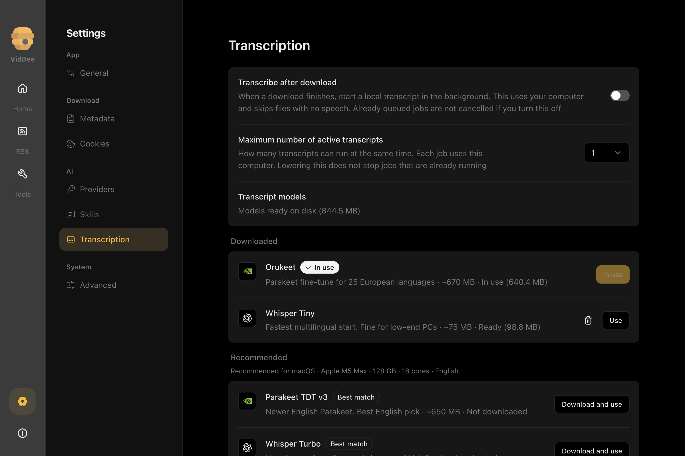
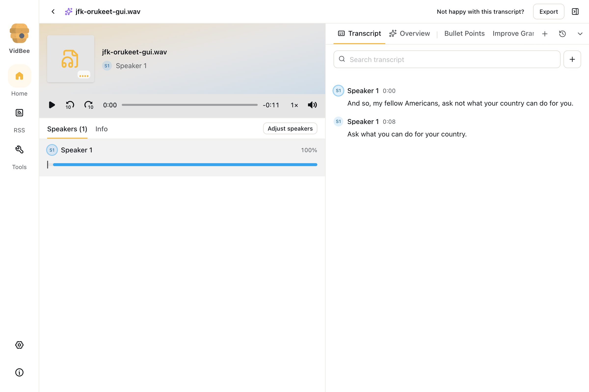

# VidBee Orukeet validation

Validated September 20, 2026 on macOS arm64 (Apple M5 Max), with VidBee's built Electron desktop application and `sherpa-onnx-node` 1.13.6. These results cover this platform; Windows and Linux native execution were not qualified.

## Automated checks

All commands below ran successfully from the repository root:

```sh
pnpm run check
pnpm run build
pnpm --filter api run typecheck
pnpm --filter @vidbee/transcription run typecheck
pnpm --filter @vidbee/downloader-core run typecheck
pnpm --filter api exec tsx --test ../../packages/transcription/tests/orukeet.test.ts ../../packages/transcription/tests/local-media-model.test.ts
pnpm --filter api exec tsc --ignoreConfig --noEmit --skipLibCheck --strict --types node --target ES2024 --module ESNext --moduleResolution Bundler ../../packages/transcription/tests/orukeet.test.ts ../../packages/transcription/tests/local-media-model.test.ts
```

**Nine regression tests passed:**

1. Optional tier and pinned, authenticated Hugging Face downloads in both mirror modes.
2. Shared API validation and persisted web settings accept Orukeet.
3. Install once, offline cache reuse, transducer path resolution and isolated removal.
4. Altered manifest/model rejection followed by a successful clean retry.
5. Malformed/incomplete authenticated manifest rejection before fetching weights.
6. Tampered cached manifest rejection before trusting another file's checksum.
7. Interrupted body cleanup and successful retry.
8. Cancellation removes the partial tier and preserves shared/sibling files.
9. Local media import queues the selected model and retains the existing default when no choice is supplied.

`pnpm run check` includes locale parity and desktop main/renderer typechecks. It exits successfully with an existing `useExhaustiveDependencies` warning in `TranscriptCaptionsPane.tsx` for `requestDeleteCaptions`; that unrelated hook warning remains. Existing Node module-type and build chunk/import warnings also remain non-fatal.

## Hugging Face acquisition

The production `ModelManager` successfully downloaded the real pinned `manifest.json`, `tokens.txt`, `LICENSE-WEIGHTS` and `NOTICE.md` from `huggingface.co` (HTTP 200), verified the content hashes and reported the model ready. A fresh manager reused the cache with fetching blocked.

The three large ONNX components were reused from existing local files whose SHA-256 values match that same pinned manifest. **A new full 671 MB model download was not performed.** Transfer failure, cancellation, cleanup, hash rejection and retry are exercised with small fixture bodies in the regression tests. No new model tensors are committed to the repository.

The checksum manifest is required by the actual installation path and used to authenticate component checksums. It is requested from the canonical Hugging Face repository, matching Hugging Face's [published NeMo download-counting rule for JSON files](https://github.com/huggingface/huggingface.js/blob/79be8748de0a3ad8e9f98b9fbf2173f56d5b2498/packages/tasks/src/model-libraries.ts#L1087-L1094). No separate telemetry call is introduced. This validates the qualifying request path, not a measured change to the public download counter.

## Built desktop application

In the built Electron app, Orukeet was selected and persisted in settings. Importing the 11-second JFK WAV queued and completed transcription with `asrTier: "orukeet"` and `speakerCount: "auto"`. The persisted result contained **22 timed words across two segments**, and the transcript was displayed in the app. This exercises the actual desktop import, worker and persistence path.





## Native inference and subtitles

The matched benchmark ran **800 successful native decodes**: 400 complete FLEURS test utterances across 25 languages for each model. All source WAV frame counts match the corresponding dataset metadata; utterances were filtered by duration, never truncated against longer references.

| Measurement | Parakeet v3 INT8 | Orukeet R3 INT8 |
| --- | ---: | ---: |
| Word error rate | 21.42% | 19.74% |
| Warm decode time over 4,082.14 s of audio | 159.24 s | 134.32 s |
| Valid token/word timing | 400/400 | 400/400 |

These are bounded local measurements, not platform-wide guarantees. Orukeet improves 20 language slices, ties one and regresses on four. [Full methods and per-language results](benchmark-public.md), [exact totals and model hashes](benchmark-public.json), and [all fixture IDs, archive members and hashes](benchmark-fixtures.tsv) are provided separately.

Six production-pipeline checks covered short speech, 66/308-second repeated speech, 276 seconds of varied multilingual clips, real speech with VAD, and silence. Offline restart/resume returned the identical result. All **232 exported SRT/VTT cues** were ordered, nonoverlapping and within the source audio; pipeline word starts were monotonic. The checks validate structural timing, not alignment error against manually labeled word boundaries.

The offline pipeline harness blocked every fetch before network access. The existing optional punctuation stage attempted to download its absent model, received an immediate offline error, and gracefully preserved recognized text. That optional fallback is unchanged. The single-speaker harness does not qualify multi-speaker diarization generally; the separate built-app smoke used the actual `auto` speaker setting.
